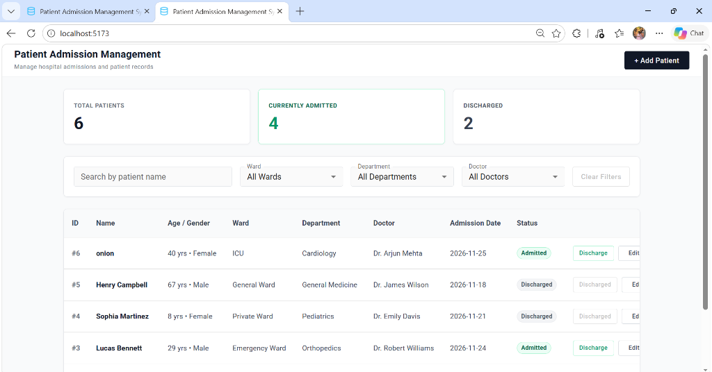
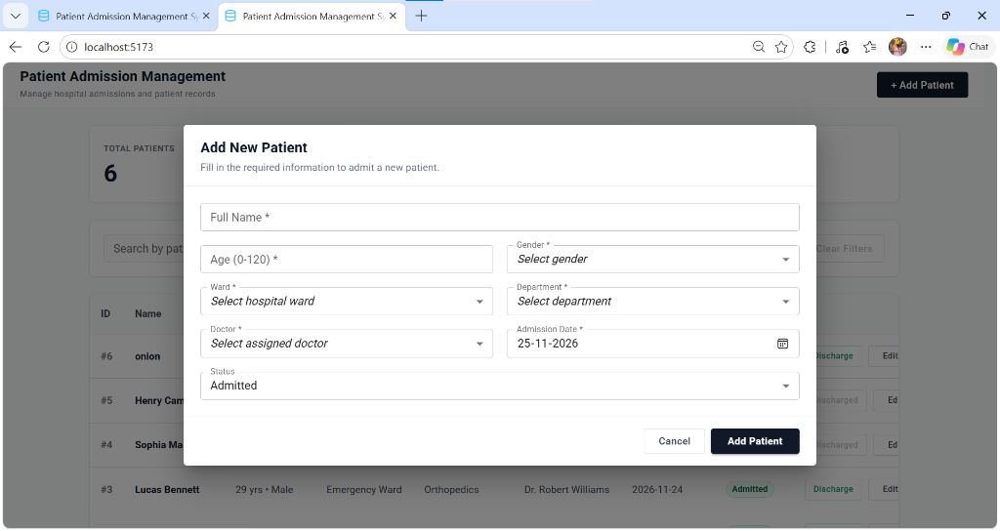
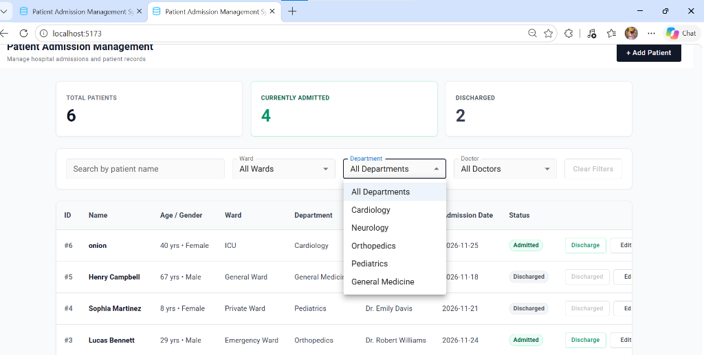

# Patient Admission Management System (PAMS)

A full-stack hospital admission dashboard where staff can manage patient admissions, records, and discharges.

---

## 1. Tech Stack

- **Frontend**: React.js (Vite), Material UI (MUI), Axios
- **Backend**: Python FastAPI, Pydantic, SQLAlchemy
- **Database**: SQLite (persists across restarts)

---

## 2. Steps to Run Locally

### Prerequisites
- Python 3.9+
- Node.js 18+

### Backend Setup
```bash
cd backend
pip install -r requirements.txt
python -m uvicorn main:app --reload --port 8000
```
- API URL: `http://127.0.0.1:8000`
- Swagger Docs: `http://127.0.0.1:8000/docs`

### Frontend Setup
```bash
cd frontend
npm install --legacy-peer-deps
npm run dev
```
- Web App: `http://localhost:5173`

---

## 3. Features

1. **Add Patient**: Register new admission with real-time validation.
2. **View Patients**: Responsive table displaying all patient details.
3. **Search**: Instant case-insensitive search by patient name.
4. **Filter**: Multi-filter by Ward, Department, and Doctor.
5. **Edit**: Update existing patient details.
6. **Discharge**: Mark admitted patients as Discharged.
7. **Delete**: Remove patient records with confirmation dialog.
8. **Summary Counts**: Real-time Total, Admitted, and Discharged counts.
9. **Responsive Design**: Works across desktop, tablet, and mobile.

---

## 4. Validation Rules

- **Name**: Required, alphabetic letters and spaces only.
- **Age**: Required, integer between `0` and `120`.
- **Gender, Ward, Department, Doctor**: Required, select from predefined list.
- **Admission Date**: Required, past or present date only (cannot be future date).
- **Backend**: Strict Pydantic validation returning HTTP 422 for invalid requests.

---

## 5. API Endpoints

| Method | Endpoint | Description |
|---|---|---|
| `GET` | `/options` | Predefined dropdown options |
| `GET` | `/patients` | Get all patients (with search/filter query support) |
| `GET` | `/patients/{id}` | Get single patient by ID |
| `POST` | `/patients` | Create new patient record |
| `PUT` | `/patients/{id}` | Update patient record |
| `DELETE` | `/patients/{id}` | Delete patient record |
| `PATCH` | `/patients/{id}/discharge` | Mark patient as Discharged |

---

## 6. Project Structure

```
PAMS/
├── backend/
│   ├── database.py       # SQLite connection setup
│   ├── main.py           # FastAPI endpoints & CORS
│   ├── models.py         # SQLAlchemy Patient model
│   ├── patients.db       # SQLite database file
│   ├── requirements.txt  # Backend dependencies
│   └── schemas.py        # Pydantic schemas & validation
├── frontend/
│   ├── src/
│   │   ├── components/
│   │   │   ├── ConfirmDialog.jsx
│   │   │   ├── PatientFilters.jsx
│   │   │   ├── PatientForm.jsx
│   │   │   └── PatientTable.jsx
│   │   ├── services/
│   │   │   └── patientService.js
│   │   ├── App.jsx
│   │   ├── index.css
│   │   └── main.jsx
│   ├── index.html
│   ├── package.json
│   └── vite.config.js
├── screenshots/
│   ├── dashboard.png     # Dashboard & patient records overview
│   ├── add-patient.png   # Add new patient modal dialog
│   └── filters.png       # Search & multi-dropdown filters
├── .gitignore
└── README.md
```

---

## 7. Live Links

- **Frontend Live**:
- **Backend Live**: 

---

## 8. Screenshots

### 1. Dashboard Overview & Patient Table


### 2. Add New Patient Admission Modal


### 3. Search & Multi-Filter Controls



